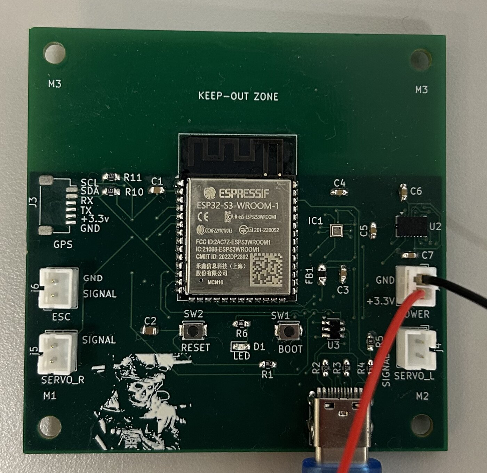

# Flight Controller — v1

Custom flight controller designed in-house for AD-1, built around an **ESP32-S3** microcontroller.

  

---

## Why a custom board?

Off-the-shelf flight controllers are designed to fit as many aircraft as possible. That versatility
comes at a cost in **size**, **weight** and **complexity**, which matters in the narrow fuselage of a
flying wing. We designed our own board for two reasons:

1. **Minimal footprint** — only what AD-1 needs is on the board. Everything else found on commercial
   flight controllers (OSD, extra UARTs, motor outputs for multirotors, SD card, current sensor…)
   was removed, so the board fits the electronics bay of the fuselage.
2. **Full control over the sensor chain** — every sensor was selected for its role in the control loop,
   and we know exactly which component produces which measurement, how it is filtered and how it
   reaches the INDI controller. There is no black box between the sensors and the control law.

---

## Architecture

| Function | Component | Role in the system |
|---|---|---|
| Microcontroller | **ESP32-S3-WROOM-1-N16** (16 MB flash) | Runs sensor acquisition, state estimation, the INDI attitude controller and actuator outputs |
| Inertial Measurement Unit | **Bosch BMI088** — 3-axis gyroscope + 3-axis accelerometer | Angular rates *ω* (rate feedback, angular acceleration for INDI) and specific force (attitude estimation via complementary filter) |
| Barometer | **Bosch BMP390** | Static pressure → barometric altitude (outer loop) |
| GNSS + compass | External **M100-5883** module (J3) | Position, ground speed, heading |
| USB | USB-C, native ESP32-S3 USB + **USBLC6-2SC6** ESD protection | Flashing, debugging, data logging |

**Sensor bus** — the BMI088 (accelerometer and gyroscope dies) and the BMP390 share one SPI bus with
dedicated chip-select lines. SPI was preferred over I²C for its higher throughput and deterministic
timing, which the INDI loop relies on. The sensors are supplied by a dedicated analog rail isolated
from the digital 3.3 V by a ferrite bead to reduce noise on the measurements.

---

## Board overview

Labels below match the silkscreen on the board.

### Connectors

| Ref | Silkscreen | Type | Pins | Connects to |
|---|---|---|---|---|
| J1 | POWER | JST-PH 2-pin | GND, +3.3 V | 3.3 V supply from the power distribution board (PDB) |
| J3 | GPS | JST-SH 6-pin | SCL, SDA, RX, TX, +3.3 V, GND | **M100-5883 GNSS + compass** — UART for GNSS data, I²C for the compass (4.7 kΩ pull-ups R10/R11) |
| J4 | SERVO_L | JST-PH 2-pin | SIGNAL | **Left elevon servo** (PWM) |
| J5 | SERVO_R | JST-PH 2-pin | SIGNAL | **Right elevon servo** (PWM) |
| J6 | ESC | JST-PH 2-pin | SIGNAL, GND | **Hobbywing 120A V4 ESC** driving the EDF (PWM throttle) |
| J2 | — | USB-C | USB 2.0 | Computer — flashing, serial monitor, data logging (ESD-protected by U3) |

> The board is powered **only** through J1: USB does not supply the board.

### Main components

| Ref | Component | Function |
|---|---|---|
| U1 | ESP32-S3-WROOM-1-N16 | Microcontroller module (dual-core, Wi-Fi/BLE, native USB) |
| U2 | BMI088 | 6-axis IMU — gyroscope + accelerometer |
| IC1 | BMP390 | Barometric pressure sensor |
| U3 | USBLC6-2SC6 | ESD protection of the USB data lines |
| FB1 | Ferrite bead | Isolates the sensors' analog 3.3 V rail from digital noise |

### Controls & indicators

| Ref | Silkscreen | Function |
|---|---|---|
| SW1 | BOOT | Hold while resetting to enter the ESP32-S3 bootloader |
| SW2 | RESET | Resets the microcontroller |
| D1 | LED | Status LED (firmware-controlled) |

### Mechanical

- 4 × M3 mounting holes (M1–M3).
- **KEEP-OUT ZONE** — no copper under the ESP32-S3 antenna, to preserve Wi-Fi/BLE range.

---

## Design files

KiCad source files are intentionally not published — see the repository [LICENSE](../../LICENSE).
